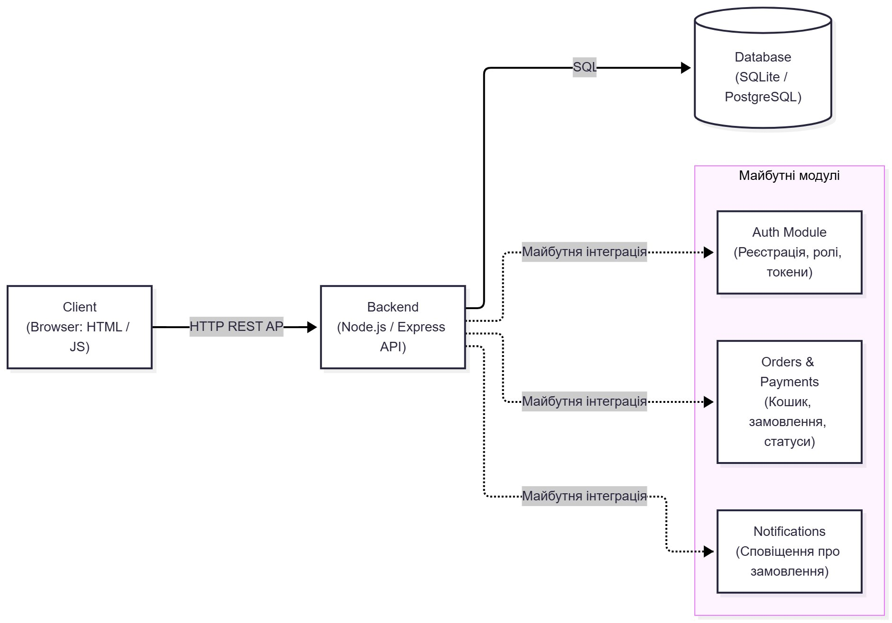

# Архітектура системи Music Store

## Опис компонентів

### Поточні модулі
* **Client (Browser / HTML + JS)** — клієнтська частина, через яку користувач взаємодіє з магазином (перегляд каталогу, відправка запитів до API).
* **Backend (Node.js / Express API)** — серверна частина, що приймає HTTP-запити від клієнта, обробляє бізнес-логіку та взаємодіє з базою даних.
* **Database (SQLite / PostgreSQL)** — реляційна база даних для зберігання товарів, користувачів та замовлень.

### Майбутні модулі
* **Auth Module** — відповідатиме за реєстрацію, вхід користувачів, перевірку токенів та розмежування прав (покупець / адміністратор).
* **Orders & Payments** — відповідатиме за роботу кошика, створення замовлень та імітацію статусів оплати.
* **Notifications** — відповідатиме за відправку сповіщень користувачам (наприклад, підтвердження замовлення або зміна його статусу).
