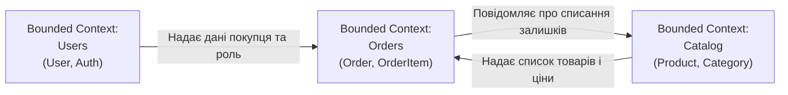

# Контекстна карта (Context Map) — Music Store

## Взаємодія контекстів
* **Users → Orders:** передає інформацію про авторизованого покупця (`userId`, роль) для оформлення замовлення.
* **Catalog → Orders:** надає актуальні дані про товари (назва, ціна, наявність) при додаванні в замовлення.
* **Orders → Catalog:** після підтвердження замовлення повідомляє каталог про необхідність зменшити залишок (`stock`).
