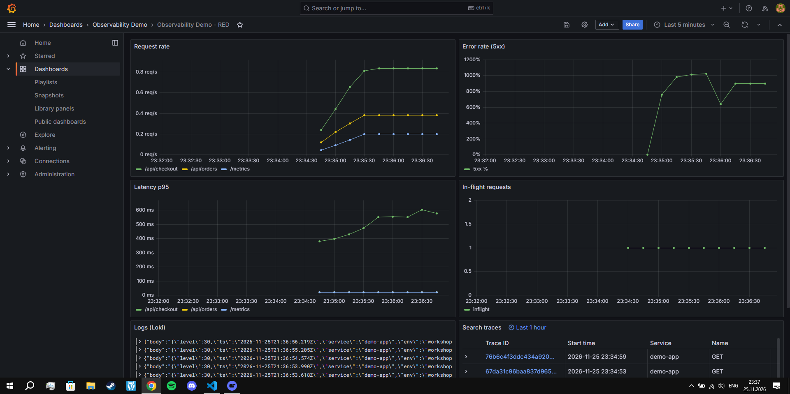
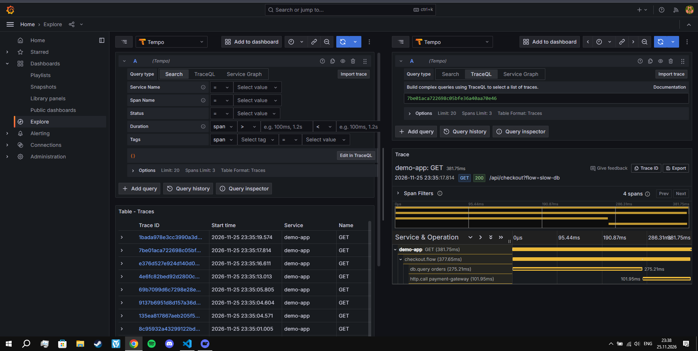
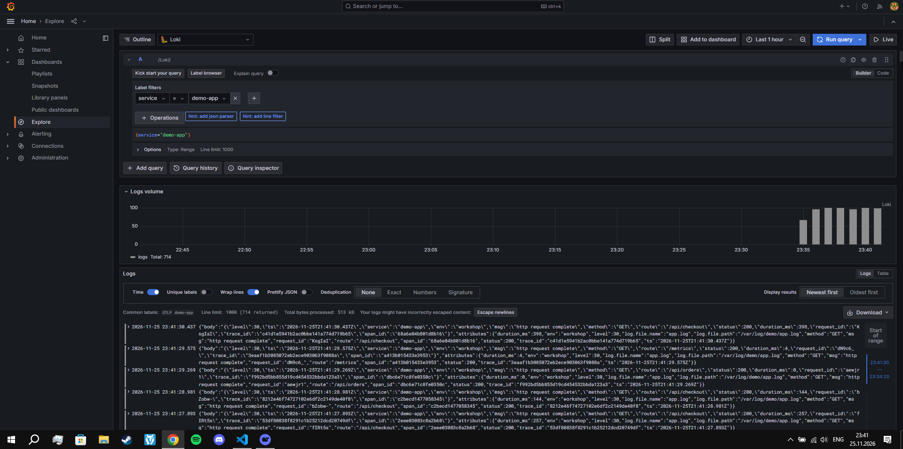

# Звіт до Практичної роботи 8: Observability (Grafana, Loki, Tempo, OpenTelemetry)

## Рівень 60 балів — Запуск стенду та базовий огляд

Стенд `observability-demo` розгорнуто локально через `docker compose up -d --build`. Перевірено доступність API (`:3000`), Grafana (`:3001`), Prometheus (`:9090`), Loki (`:3100`) та Tempo (`:3200`), трафік згенеровано контейнером `loadgen`.

### 1. Вбудований RED-дашборд (Grafana + Prometheus)

На дашборді відображаються базові RED-метрики сервісу `demo-app`: інтенсивність запитів (Rate), кількість помилок (Errors) та час відповіді (Duration). Видно, що сервіс стабільно обробляє трафік від `loadgen` із періодичними тестовими помилками.

### 2. Розподілені трейси (Tempo)

На скріншоті відкрито окремий trace запиту в Tempo із деталізацією спанів та часом виконання кожного етапу. Це дозволяє простежити повний шлях запиту всередині сервісу та знайти вузькі місця.

### 3. Логи сервісу (Loki)

У Grafana Explore через Loki відображаються структуровані логи сервісу `demo-app` із мітками часу та рівнями логування, що дозволяє швидко фільтрувати події та помилки.

---

## Рівень 75 балів — Власний RED-дашборд (`My Demo RED`)

* **Експортований JSON дашборду:** [`my-demo-red-dashboard.json`](./my-demo-red-dashboard.json)


### Опис панелей та використаних запитів

1. **Requests per second (Rate)**
   ```promql
   sum(rate(http_server_requests_total{service_name="demo-app"}[5m]))
   ```
   Показує кількість HTTP-запитів за секунду до сервісу `demo-app` у 5-хвилинному вікні. У проді дозволяє відстежувати піки навантаження, аномальні сплески трафіку або раптове падіння запитів.

2. **Error rate (Errors, %)**
   ```promql
   100 * sum(rate(http_server_requests_total{service_name="demo-app", status_code=~"5.."}[5m])) / sum(rate(http_server_requests_total{service_name="demo-app"}[5m]))
   ```
   Показує відсоток серверних помилок (`5xx`) від усіх запитів. У проді це головний індикатор деградації сервісу після релізу або збоїв залежностей.

3. **Latency p95 (Duration)**
   ```promql
   histogram_quantile(0.95, sum by (le) (rate(http_server_request_duration_seconds_bucket{service_name="demo-app"}[5m])))
   ```
   Показує 95-й перцентиль тривалості обробки запиту. У проді допомагає вчасно помітити гальмування БД або зовнішніх API, яке маскується середнім часом відповіді.

4. **Логи сервісу (Loki)**
   ```logql
   {service_name="demo-app"} |= "error"
   ```
   Виводить потокові логи сервісу `demo-app` із фільтрацією помилок. У проді використовується одразу після сплеску Error rate для пошуку причини збою.
